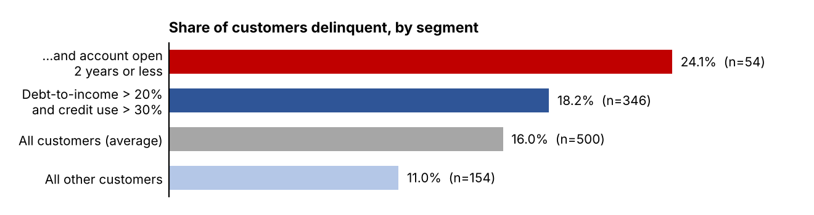

# Credit Card Delinquency Risk Analysis — Tata iQ Job Simulation

End-to-end analytics project completed as part of the **Tata iQ GenAI Powered Data Analytics Job Simulation** on [Forage](https://www.theforage.com/). Acting as an AI transformation consultant, I analyzed customer credit data for *Geldium Finance* (a fictional lender), planned a delinquency prediction model, wrote a stakeholder report for the Head of Collections, and designed a responsible, AI-powered collections system.

> This is a virtual job simulation, not employment with Tata. The analysis was carried out with the help of GenAI tools, as the simulation intends, and every figure was verified by running code on the data.



## Business problem

Geldium has seen a rise in credit card delinquency (payments more than 30 days late). The Collections team relies on manual case handling and wants a data-driven way to identify at-risk customers and prioritize outreach, while staying fair, explainable and compliant.

## What I did

| Stage | Deliverable | Summary |
|---|---|---|
| 1. Exploratory data analysis | [EDA Summary Report](reports/1_EDA_Summary_Report.pdf) | Audited 500 customer records for missing values, inconsistent labels and logical conflicts; diagnosed missingness (MCAR/MAR) and chose an imputation strategy |
| 2. Predictive model plan | [Predictive Model Plan](reports/2_Predictive_Model_Plan.pdf) | Selected logistic regression with a decision-tree benchmark, defined an evaluation and fairness-testing plan, and tested a baseline pipeline |
| 3. Business report | [Business Summary Report](reports/3_Business_Summary_Report.pdf) | Translated findings into the top 3 risk factors and a SMART pilot recommendation for the Collections team |
| 4. AI collections strategy | [Strategy Presentation](reports/4_AI_Collections_Strategy.pdf) | Designed an agentic AI collections system with risk tiers, human oversight, locked actions and responsible AI guardrails |

The full analysis is in [`notebooks/eda_and_modeling.ipynb`](notebooks/eda_and_modeling.ipynb).

## Key findings

**Data quality is the main risk, not missing values.**
- Missing data is limited: Income 7.8%, Loan_Balance 5.8%, Credit_Score 0.4%. No duplicate records.
- Employment_Status uses three labels for the same group ("Employed", "employed", "EMP"), and ratios are stored as decimals although the data guide describes them as percentages.
- For **141 customers (28%)**, the 12-month missed-payment count is lower than the number of missed months in the last six months alone, which is impossible. Credit score and missed payments are essentially unrelated (Spearman ρ = −0.01).

**Missing data was diagnosed before it was treated.**
- Missing Income shows no relationship with delinquency or other variables (consistent with MCAR).
- Missing Loan_Balance is linked to a lower debt-to-income ratio (p = 0.006), so it is MAR.
- Treatment: median imputation plus missing-value flags, instead of deleting 64 customers (12.8%), 11 of them delinquent.

**Risk signals are weak but point in the expected direction.**

| Risk factor | Delinquency rate if true | If false |
|---|---|---|
| Debt-to-income > 20% | 17.2% | 9.8% |
| Credit utilization > 30% | 16.8% | 12.0% |
| Account tenure ≤ 2 years | 20.8% | 15.1% |

Customers with **both** high debt-to-income and high credit use hold **79% of all delinquent customers** (63 of 80; p ≈ 0.05), though this segment also covers about 70% of the customer base.

**Baseline models perform at chance level.**

| Model (5-fold CV, repeated 10×) | AUC-ROC | Recall | Precision |
|---|---|---|---|
| Logistic regression | 0.47 | 0.41 | 0.14 |
| Decision tree (depth 3) | 0.49 | 0.64 | 0.15 |

An AUC of about 0.5 means the model ranks customers no better than random, so neither model meets the deployment criteria (AUC ≥ 0.70, recall ≥ 0.70).

## Recommendations

1. **Fix the data first:** reconcile the delinquency and payment-history fields with the data owner, standardize labels and units.
2. **Run a controlled pilot instead of a full rollout:** an 8-week supportive outreach pilot (reminders and repayment-plan offers) for the high-debt / high-credit-use segment, with a randomized comparison group and a target of at least a 10% reduction in 30+ day delinquency.
3. **Use a readiness gate:** let model scores drive decisions only after the model reaches AUC ≥ 0.70 and passes fairness tests.
4. **Keep humans in control:** automate low-risk, supportive actions only, and never automate punitive actions such as raising interest rates or cutting credit limits.

## Responsible AI considerations

- Age and Location are excluded as predictors and used only to audit fairness (disparate impact with the four-fifths rule, equalized odds).
- Every customer-facing action carries a plain-language reason; SHAP reason codes are planned once a model is live.
- Contact limits are modeled on CFPB Regulation F as best practice.

## Repository structure

```
├── README.md
├── requirements.txt
├── data/
│   └── README.md            # how to obtain the dataset (not included)
├── images/
│   └── segment_chart.png
├── notebooks/
│   └── eda_and_modeling.ipynb
└── reports/
    ├── 1_EDA_Summary_Report.pdf
    ├── 2_Predictive_Model_Plan.pdf
    ├── 3_Business_Summary_Report.pdf
    └── 4_AI_Collections_Strategy.pdf
```

## How to run

1. Enroll in the Tata iQ simulation on Forage and download `Delinquency_prediction_dataset.xlsx`.
2. Place it in the `data/` folder.
3. Install dependencies and open the notebook:

```bash
pip install -r requirements.txt
jupyter notebook notebooks/eda_and_modeling.ipynb
```

## Tools

Python, pandas, NumPy, SciPy, scikit-learn, Matplotlib, Jupyter, Microsoft Word, PowerPoint, Generative AI (Claude)

## Author

**Helga Yuliani Putri Aritonang** — Informatics graduate, Universitas Mikroskil
